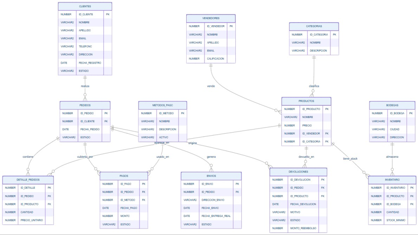

# Marketplace — Base de datos Oracle + aplicación APEX

Sistema de comercio electrónico tipo *marketplace* (clientes, vendedores, productos, pedidos, pagos,
envíos, devoluciones e inventario por bodega), modelado en **Oracle Database 21c XE** y con una
aplicación web construida en **Oracle APEX 26.1**.

Proyecto del curso **Bases de Datos II** — Ingeniería de Sistemas, UPTC Seccional Sogamoso (2026-1).
Desarrollado en equipo.



## Qué incluye

**Modelo relacional (3FN)**
- 12 tablas con sus PK y FK; todas las relaciones son 1:N (se eliminaron las 1:1 y N:M del diseño inicial,
  por ejemplo con la tabla `BODEGAS` entre `PRODUCTOS` e `INVENTARIO`).
- Campos derivados (totales, subtotales) eliminados para cumplir 3FN.

**Consultas y reportes**
- Consultas con `JOIN` y subconsultas avanzadas (incluye subconsultas correlacionadas).
- 5 vistas analíticas con `RANK() OVER`, `CASE WHEN` y agregaciones:
  `ingresos_por_categoria`, `ranking_productos`, `rentabilidad_vendedor`,
  `comportamiento_clientes`, `control_inventario`.

**Lógica de negocio con triggers (PL/SQL)**
| Trigger | Qué hace |
| --- | --- |
| `trg_reducir_stock` | Descuenta stock al registrar un detalle de pedido |
| `trg_validar_stock` | Impide vender si el stock es insuficiente |
| `trg_pago_completo_estado` | Actualiza el estado del pedido cuando se completa el pago |
| `trg_auditoria_precios` | Registra en `auditoria_precios` cada cambio de precio |
| `trg_bloquear_del_vendedor` | Impide eliminar un vendedor con productos activos |
| `trg_validar_inventario` | Rechaza inventario con cantidad negativa o bodega inactiva |

**Aplicación APEX ("Marketplace Dashboard")**
- Dashboard, login y páginas CRUD con *Interactive Grid* y formularios para
  Productos, Vendedores, Inventario, Pedidos, Detalle de pedidos y Pagos.

## Estructura

```
sql/
  01_creacion_tablas.sql     tablas, PK, FK y restricciones
  02_datos_prueba.sql        datos de prueba (ficticios) y validación
  03_consultas_join.sql      reportes con JOIN
  04_subconsultas.sql        subconsultas avanzadas
  05_vistas.sql              5 vistas analíticas
  06_triggers.sql            6 triggers de negocio
  07_fix_estado_pagado.sql   agrega el estado PAGADO y ajusta el trigger de pagos
apex/
  f26201.sql                 export de la aplicación APEX
docs/
  modelo-er.png              diagrama entidad-relación
```

## Cómo ejecutarlo

1. En Oracle 21c XE, crea un usuario/esquema (en el proyecto se llamó `marketplace`) y conéctate con él.
2. Ejecuta los scripts de `sql/` **en orden numérico** desde SQL*Plus o SQL Developer
   (por ejemplo `@sql/01_creacion_tablas.sql`).
3. En APEX: **App Builder → Import**, sube `apex/f26201.sql` y asígnale el esquema del paso 1.

## Tecnologías

Oracle Database 21c XE · SQL · PL/SQL · Oracle APEX 26.1
